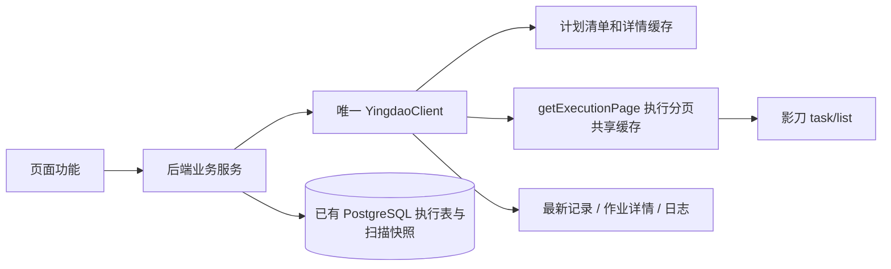

# 影刀数据采集、缓存和显示偏好

## 统一入口与数据边界

后续API使用原则：**能复用就复用，不能复用再单独请求。** 新功能先检查已有客户端、进行中的请求、缓存、数据库记录与扫描快照；确认数据语义、范围、权限、完整性、时效均满足需求后复用。不满足时通过统一客户端单独请求，并在本文对应调用链中记录原因、范围、刷新策略及采集时间；保存前强制核验等必要请求继续保留。

运行时只创建一个 `YingdaoClient`，通过 `server/runtime.cjs` 注入所有业务服务。Token、401刷新、限流、重试及超时共用。页面轮询本地接口不等于向影刀重新扫描。

数据按语义复用。计划是否启用、执行是否成功、是否无重试是不同事实，各自保留核验范围和时间。不能把某个接口刚成功返回当作所有数据均已同步。

| 用途 | 影刀数据及入口 | 复用方式 | 完整性与更新时间 |
| --- | --- | --- | --- |
| 计划差异核对 | schedule/list 启用及停用清单、schedule/detail；scheduleReconciliation | PostgreSQL扫描快照供全员查看，普通打开弹窗不重新扫描；详情共用客户端缓存 | scanned_at 是整次配置核对时间；登录后距上次核对30分钟才自动扫描。执行差异前仍重读清单/详情，不能使用过期结果代替校验 |
| 表单自动填写、Cron和候选机器 | schedule/detail；getScheduleDetail/getEditorPlan | 现有60秒详情缓存及相同请求并发合并；网络失败仅在原可信窗口内返回明确标记的旧结果 | fetched_at/fetchedAt 是源数据采集时间；stale必须保留 |
| 全局执行增量同步 | task/newest/list；syncCoordinator | 写入现有rpa_task_executions；各页面读取同一张执行表 | 每60秒运行，甘特图打开、浏览器刷新或点击页面「刷新」也通过 `POST /api/tasks/sync` 触发，并发触发共用同一批同步。last_synced_at标记该同步完成；这里只提供最新记录，不能据此认定循环任务当日历史完整 |
| 当天逐次状态条 | task/list；todayExecutions → getExecutionPage | 与最近运行候选共用20条游标页；通过applyRecords幂等写入同一执行表，全员共享结果 | 上海时区今天，从最新页向前读至昨日或明确结束；每计划至少间隔60秒补齐，前端按核对策略读取本地批量接口。state=ready才代表本次当日范围读取完整 |
| 最近10次无重试成功 | task/list → getExecutionPage，再核验task/query和task/process/detail；scheduleEditor | 原始候选页共用；最终统计保留30秒、最多40计划缓存及相同请求合并 | 最多检查10页×20条，详情与过程仍需核验无异常、无重试，不能拿当天成功横条直接当作合格样本；不足10条如实返回，search_limit_reached标识检查上限 |
| 个人/单任务历史同步 | listTaskHistory → getExecutionPage | 相同计划、起止范围、页大小及游标共用分页缓存，并写入同一执行表 | 请求保留自己的历史窗口，不能用仅覆盖今天的结果冒充历史已完整；沿用绑定区间、代次及单任务同步时间 |
| 立即执行、活动轮询、作业和日志 | task/start、task/query、task/job/process等现有入口 | Token和限流共用；日志沿用原独立短缓存 | 发起执行和活动轮询不能用历史分页缓存替代；读日志按需进行，不保存完整日志到数据库 |

甘特图状态条按当日定时触发着色，悬浮提示显示触发时刻。开启状态条后，编辑卡片复用甘特图的定时状态，并单独显示所有触发方式中的最近一次运行和实际触发时间。不同执行记录按各自状态显示；影刀未提供关联的 API 执行不会覆盖原定时状态。

同步窗口的「需人工处理」对有权限的已绑定本地任务提供单条「修改」和「删除」。修改打开原任务编辑窗口，可换绑或保存本地设置。删除确认后复用任务批量保存接口软删除并保留审计，影刀计划独立保留。任务已删除或换绑时，当前页面过滤旧绑定的人工处理条目。

## 执行分页共用规则

实现：`vue/server/services/yingdaoClient.cjs` 中的 `getExecutionPage(params, { forceRefresh })`。所有执行历史分页业务应使用此入口，不能另建一套直连影刀的分页缓存。

- 缓存键由规范化后的完整请求参数组成，字段排序后序列化。计划UUID、游标、方向、每页条数、开始/结束时间等任何范围差异都隔离；大整数游标始终为精确字符串。
- 相同请求并发时只向影刀发一次；成功页缓存15秒，最多400页，所有账号在同一服务进程内共用。重启后短缓存自然清空。
- 命中返回原始 `fetched_at`，不因另一个功能读了缓存就把采集时间刷新成现在。返回结果深拷贝，消费者过滤和修改不会污染缓存。
- `forceRefresh: true` 跳过已完成的短缓存，仍合并正在进行的相同采集。错误和缺少记录列表的响应不入缓存，过期后的读取失败也不冒充成功。
- 计划配置的强制核验不经过这个执行分页缓存，原有保存前校验保持独立。

当天状态与最近十次候选均使用不加时间条件的20条游标页，因此可复用相同首屏及后续页。当天服务在本地按北京时间过滤，并继续读到昨日/历史结束，保留全部状态及重试成功；最近十次服务读取同样的原始候选后，再执行自己的纯净成功筛选。明确时间范围的历史请求只和相同范围共用，不能跨范围猜测覆盖关系。

例：先为计划A读取当天记录，1次请求取得20条候选且遇到昨日；随后15秒内打开A的最近运行模块，可直接复用这20条原始记录，不再请求同一页。后续核验无重试成功需要的详情和过程仍按需查询。该优化不承诺一次请求覆盖所有计划及所有用途。

最近一次运行取同一历史游标的首条记录，包含失败、停止和进行中的运行，与十次纯净成功统计分开。已停止、失败或超时的已绑定任务可由所有者或管理员确认重试。重试复用立即执行接口启动当前影刀计划，并在锁定任务时校验预期绑定 UUID，避免换绑后误执行。

## 时间与失败语义

今日运行状态提示统一放在SchedulePage的header-meta右上角，替换旧“影刀数据截至”，GanttChart内不重复显示；关闭运行状态时显示“今日定时运行状态未开启”。“正在更新N个计划”统计当前查询结果中state=loading的源任务，包含排队与实际读取中的任务，并非N条差异，也不代表N个并发请求。后台单批只有两个worker，完成一个计数减少一个。

今日明细核对在显示开关开启时持续运行：首次打开/刷新并开启功能时使用refresh=force，跳过已完成的分页缓存，正在采集的相同请求仍合并；失败后保留强制意图并按周期重试。之后每60秒使用refresh=due，refresh_ids只包含本页面当天尚未观察到成功记录的计划；今天任一次成功即停止该计划的专用明细核对，循环任务也一样，后续触发需刷新/重开再强制查询。成功标记仅在当前页面内存保存，换绑和跨上海午夜失效。处理中每15秒使用refresh=cache只读本地结果，不能触发影刀请求。请求参数必须去重且refresh_ids为task_ids子集，登录权限与绑定区间校验保持不变。

隐藏标签页或窗口失焦时继续使用原轮询计时，保留在途请求。重新可见或窗口聚焦时，若浏览器延迟了后台计时，则立即补查已到期且尚未成功的计划。单次页面请求超过15秒时显示超时并自动重试。全部成功时不再轮询，刷新或重新打开恢复首次强制核对；上海午夜会清空成功标记并按新一天处理。关闭开关/卸载停止专用页面请求，已入队的后台批次继续完成；同一服务全员合计最多两条采集worker，新请求追加队列、相同日期/绑定任务合并。原服务器全局增量同步、配置扫描等其他业务不受此开关和焦点策略影响。

- 原始页 `fetched_at`：真实源采集时间，缓存命中不变。
- 当天任务元数据 `fetched_at`：本次完整读取涉及的所有页中最早的采集时间；`completed_at`：完整性核验和执行表写入完成时间。两者区分数据新鲜度与工作完成时间。
- 最近十次结果 `fetched_at`：候选页中最早采集时间；`completed_at`：候选筛选及详情核验完成时间。已有30秒统计缓存不改写这些时间。
- 配置扫描 `scanned_at`、任务 `last_synced_at` 保留原领域含义。不要改成一个全局时间后让其他模块误判无需读取。
- 读取中/失败保留有效旧数据并明确提示；缺页、顺序异常、重复游标、绑定不一致不得标记完整。日期以Asia/Shanghai为准，换绑前记录不显示到新绑定。

## 浏览器设置

统一由 `vue/src/services/browserPreferences.js` 管理显示Cookie。每次成功登录及恢复有效登录会话都按原值续期一年，进入组件时也续期；退出登录不删除显示偏好，不修改服务端登录Cookie。

| Cookie | 默认 | 入口 |
| --- | --- | --- |
| pytaskgantt.showHiddenTasks | 关闭 | 甘特图设置：显示隐藏任务 |
| pytaskgantt.showTaskNames | 开启 | 甘特图设置：任务条上显示名称 |
| pytaskgantt.showRunStatus | 关闭 | 甘特图设置：显示今日运行状态 |
| pytaskgantt.showCurrentTimeLine | 关闭 | 甘特图设置：显示当前时间线 |
| pytaskgantt.showReferenceLines | 开启 | 甘特图设置：统一显示8:30和17:30参考线 |
| pytaskgantt.timelineAutoScroll | 关闭 | 甘特图设置：自动滚动 |

设置开关即时生效，无需“保存名单”；“保存名单”只保存数据库中全员共用的is_hidden名单。显示偏好按浏览器保存，名单按数据库全员共享，二者不要混用。

关闭今日运行状态后，页头显示planSyncStore.state.result中最近一次成功计划配置扫描快照的scanned_at，标为“计划配置缓存截至”。该快照来自原有共享状态读取，不额外扫描；扫描中/失败继续保留上次成功结果，无成功结果时显示暂无有效计划配置缓存。禁止使用执行同步last_synced_at、sync_cutoff、扫描started_at冒充配置缓存时间。开启运行状态后仍显示当天执行记录完整读取的fetched_at。当前页面失焦或切到后台时继续核对。visibilitychange和focus仅用于补查已错过的轮询。服务器全局同步独立运行。

当前时间线由GanttChart.showCurrentTimeLine控制，默认关闭，Cookie保存及登录续期一年；独立于自动滚动、运行状态与8:30参考线。只用浏览器当前时钟映射上海时分秒到DUMMY_DATE，每秒setCustomTime，不请求API、不滚动视窗；午夜回到每日模板零点。复用参考线的最大缩放阈值、竖排经文彩蛋与高度填充，绿色虚线区分固定灰线。关闭清除计时器并removeCustomTime，卸载也清理；指针交互关闭，不能拖动参考线。

任务名称按实际渲染的表情文本矩形末端避让，不使用固定单表情宽度。首次绘制尚无DOM时按完整emoji字素预留空间，绘制后、平移缩放、筛选和尺寸变化时再测量。文字保持透明底白色阴影，每条轨道一次，不改变任务真实时间范围。

任务条高度26px；底部状态取任务条继承圆角并仅显示最下方4px，避免独立圆角形成另一块胶囊。bot_1固定琥珀色#b7791f，与成功绿色区分；筛选前后颜色一致。

## 验证

相关测试：`execution-page-cache.node.test.cjs`、`today-executions.node.test.cjs`、`schedule-editor.node.test.cjs`、`frontend-displayPreferences.test.js`、`frontend-hiddenTasks.test.js`、`frontend-gantt.test.js`。需覆盖并发合并、15秒过期、范围隔离、强制刷新、失败不回退、缓存容量、调用者隔离、Cookie续期、多表情避让、跨日/换绑/重试/候选机器和开关关闭。

本次无需DDL或数据库迁移，不修改及执行影刀计划。当前实现以单个Node服务进程为短期分页缓存共享范围；多进程部署需要另行设计跨进程合并，不能声称已支持。

8:30和17:30固定参考线由同一个showReferenceLines及Cookie pytaskgantt.showReferenceLines控制，默认开启、登录续期一年。首次未保存新Cookie时兼容旧showEarlyReferenceLine值；写入新设置后以新键为准。标记ID为schedule-reference及schedule-reference-evening，不再创建5:30标记。两条线共用虚线和最大放大经文样式，切换同时添加/移除两条线，不影响当前时间线和视窗。

## 自定义机器颜色与共享提示

设置内“机器颜色→自定义颜色”按当前全部源任务及其候选机器列出机器人，提供调色板、饱和度调节与恢复默认。颜色即时生效并按浏览器保存，不修改任务字段、版本、影刀配置或数据库；普通任务与候选投影均按当前显示的bot名称覆盖颜色，甘特图、列表与个人任务保持一致，筛选不改变已保存颜色。

运行状态颜色唯一来源为shared/runStatusColors.mjs，底部状态条和自定义色校验均引用它。machineColors.mjs只按OKLab欧氏色差小于0.075禁止近似色，不再整段排除色相或低饱和度，因此明显不同的深浅色、黑白及其他灰阶可以选择。调色板24个色相×11个亮度档，共264个色块，并可调节饱和度；每个色块按同一规则判断，禁用色直接显示#9b9b9b灰色且原生disabled，不加圆形覆盖，不提供推荐色。选择合法色后点击应用；保存入口、Cookie读取同样校验，不能通过UI以外输入绕过。此限制用于自定义颜色；恢复默认沿用原有默认配色。

每台机器独立Cookie：pytaskgantt.machineColor.<URL编码的bot名称>，值为六位HEX（不含#），Path=/、SameSite=Lax、HTTPS时Secure，有效期一年。独立Cookie避免单个JSON Cookie超过4KB，renewDisplayPreferences在有效登录时统一续期这些合法颜色Cookie。恢复默认删除该机器Cookie，不能清空其他设置或其他机器颜色。

machineColorPreference提供页面共享响应状态和纯显示覆盖；applyMachineColors不改变源任务或_sourceTask。候选执行描述统一用shared/scheduleDispatch.mjs的candidateExecutionText，从sourceTask完整schedule_dispatch.clients提取全部机器名，不使用单个candidate_client或筛选后的投影列表。甘特图悬浮、侧栏标题、任务列表共享标记均复用；长名单允许换行且提示框限制在视口内。

相关验证：frontend-machineColors.test.js覆盖状态原色/近似色拒绝、推荐色允许、Cookie续期、源任务不变及恢复默认；frontend-gantt.test.js覆盖参考线联动和仅显示一个候选条目时仍展示完整名单。

## API缓存保存位置

缓存主要在服务端。当前预览版后端进程和PostgreSQL均运行于本机，数据库为localhost:5432/pytaskgantt_ui_preview_20261028。内网客户端共用这份后端内存与数据库，不会各自保存一份完整API缓存。

| 数据 | 保存位置 | 生命周期与共享 |
| --- | --- | --- |
| 原始执行分页 | YingdaoClient.executionPageCache后端内存 | 15秒、最多400页，同进程账号共享，后端重启丢失 |
| 计划清单/详情、最近十次合格运行统计 | 后端各自受控内存缓存 | 计划通常60秒，统计30秒最多40计划，保留自己的采集时间 |
| 当天核对覆盖状态、队列 | todayExecutions后端内存 | 按上海日期/任务/绑定区间隔离，重启重新核对 |
| 已绑定任务执行记录 | PostgreSQL rpa_task_executions | 持久保存，按原执行保留策略清理，全员共用 |
| 计划配置扫描快照及白名单 | PostgreSQL对应scan_snapshots/whitelist表 | 持久保存并全员共用，重启后可恢复上次成功结果 |
| 当前显示的数据、成功后停止核对标记 | 当前页面Vue内存 | 刷新或重开重新建立，不上传为服务端权威缓存 |
| 开关及机器颜色 | 浏览器Cookie | 当前浏览器偏好，一年并在登录时续期 |
| 扫描结果已读状态 | 按账号隔离的浏览器localStorage | 只存已读回执/红点信息，不保存完整配置扫描数据 |

应用迁移后短缓存跟随后端进程；持久缓存位置由DATABASE_URL决定，数据库迁移需另行处理。

## 审查补足：编辑保护、采集失败及事务一致性

TaskEditor对已有任务不再用getScheduleEditor返回的defaults.start覆盖本地时间；新增自动填写逻辑和用户输入保护保留。dataService.timeToMinutes保留秒精度，formatDuration输出非零时分秒片段，isCrossDay比较完整时刻。

scheduleEditor.getRecentRuns把接口异常计入verification_failed_count，不计入skipped_count（仅不合格记录），并设置incomplete。部分已核验样本的最大/最小/平均值仅供参考，rounded_duration_seconds为null；ScheduleDirectory不缓存incomplete统计。UI显示核验失败及重试提示，差异一键新增检测失败计数并以RUN_HISTORY_UNAVAILABLE终止，不能误用无记录默认值。候选分页仍经统一getExecutionPage，复用范围及真实fetched_at保持原规范。

scheduleReconciliation.apply生成appliedJob后，将stateRepository.save作为applyBatch的beforeCommit回调执行；保存方法显式接受executor，任务、审计、操作历史、扫描快照使用同一事务连接。回调失败则ROLLBACK，内存条目只有提交成功才标记applied。普通后台扫描保存仍使用pool。此内部回调不从HTTP输入接受。

隐藏名单事务锁定完整任务行，经addAudit/appendTaskHistory同时保存审计和完整JSON快照并执行每任务50条清理。快照schema_version仍为1，新增可选is_hidden及operation_scope:'visibility'，无需迁移或修改旧迁移。隐藏操作及其还原必须在前后快照均为visibility且其他字段相同的情况下，才允许按管理员权限执行；还原仅写is_hidden，不更改version/updated_at或调用影刀。普通配置记录仍按所有者/管理员授权；旧快照缺少is_hidden时保留当前值。删除任务拒绝隐藏状态还原。前端以隐藏/恢复显示/还原隐藏状态区分记录，预览明确只影响隐藏状态。

当前设置主菜单：“自动滚动”、机器颜色入口、参考线、当前时间线、显示隐藏任务（开关与设置名单按钮同项）、任务名、运行状态。机器颜色及隐藏名单为二级菜单；自动滚动Cookie及刷新定位行为保持原约定。测试环境与现有迁移保持不动。

编辑窗口换绑：使用后端can_edit授权显示入口，真实任务ID及已有绑定才可使用。TaskEditor检测表单输入后阻止换绑；父页面复用现有草稿检查及确认窗口，以原版本调用现有POST /tasks/:id/rebind。换绑成功先用API任务响应更新编辑窗口，再刷新列表；列表只有绑定相同且版本不低于响应时才覆盖，避免silent刷新跳过时读到旧缓存。请求中禁止取消/重复提交；失败保留原绑定。普通预览/保存不承担换绑。

最近10次运行日期单独使用formatRunDateTime，不改变其他日期展示。统一Asia/Shanghai、24小时及完整星期；影刀不带时区字符串补+08:00，UTC时间先换算北京时间再判断星期。

隐藏名单收紧为管理员写、已登录用户读：路由和tasksRepository.setVisibility双重检查可信actor.isAdmin，拒绝返回ADMIN_REQUIRED。前端canManageHidden由auth.user.is_admin传入两页TaskEditor及HiddenTasksDialog，普通用户只提供查看名单和浏览器显示开关。隐藏历史can_restore与preview/restore同步收紧；正常任务历史还原对非管理员强制沿用current.is_hidden，避免通过完整快照绕过名单权限。会话每次请求重查用户角色，无需重建数据库或迁移，未改变当前账号角色。
